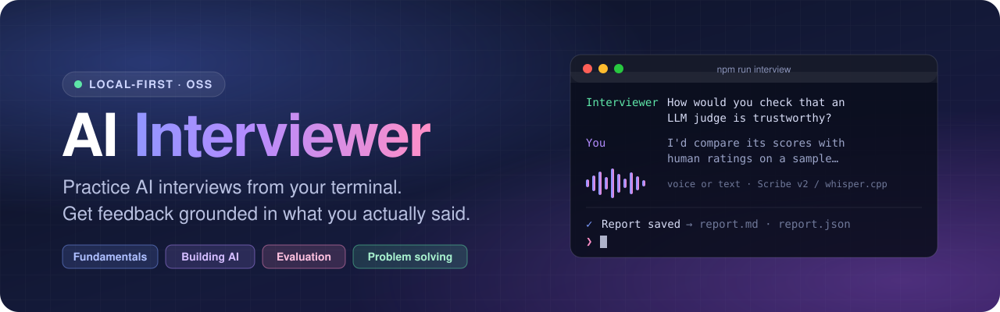
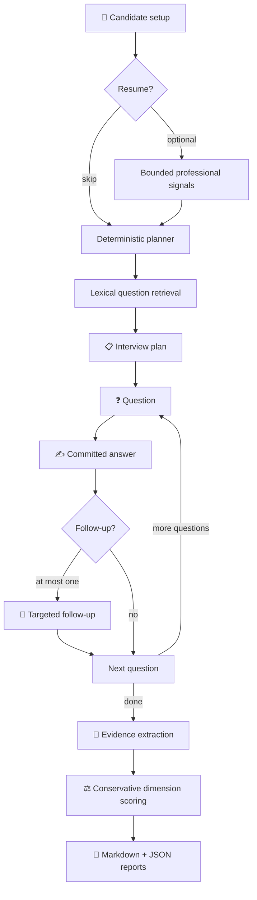

<div align="center">



<br />
<br />

<p>
  <a href="https://github.com/kaurai/ai-interviewer/blob/main/LICENSE"></a>
  
  
  
</p>
<p>
  
  
  
  <a href="https://github.com/kaurai/ai-interviewer/stargazers"></a>
</p>

<h3>Practice AI interviews from your terminal.<br/>Get feedback grounded in what you actually said.</h3>

<p>
  <a href="#-quick-start"><b>Quick start</b></a> ·
  <a href="#-features"><b>Features</b></a> ·
  <a href="#-how-it-works"><b>How it works</b></a> ·
  <a href="#-cli-reference"><b>CLI</b></a> ·
  <a href="#%EF%B8%8F-speech-to-text-setup"><b>Voice</b></a> ·
  <a href="#-http-api"><b>API</b></a> ·
  <a href="#-troubleshooting"><b>Troubleshooting</b></a>
</p>

</div>

<br />

> [!NOTE]
> AI Interviewer is **practice software, not a hiring assessment**. The
> deterministic evaluator scores only what it can support from the committed
> transcript and deliberately leaves technical accuracy and other unsupported
> dimensions unassessed.

## ✨ Features

<table>
  <tr>
    <td width="50%" valign="top">
      <h4>🎯 Four AI interview tracks</h4>
      Builds a seniority-aware interview on <b>AI fundamentals</b>, <b>building AI systems</b>, <b>evaluating AI models</b>, or <b>applied AI problem solving</b> from a validated 100-question bank.
    </td>
    <td width="50%" valign="top">
      <h4>📄 Resume-aware questions</h4>
      Reads TXT, Markdown, PDF, or DOCX resumes and extracts bounded professional signals to improve question selection. Those signals never raise a score.
    </td>
  </tr>
  <tr>
    <td valign="top">
      <h4>🎙️ Voice or text answers</h4>
      Type your answers or submit audio files. Transcription uses ElevenLabs Scribe v2 with a fully local whisper.cpp fallback, and you can correct the draft before you commit it.
    </td>
    <td valign="top">
      <h4>🔁 Adaptive follow-ups</h4>
      Asks at most one targeted follow-up per main question by default, using probes drawn from the question bank.
    </td>
  </tr>
  <tr>
    <td valign="top">
      <h4>🧾 Evidence-grounded reports</h4>
      Produces Markdown and JSON feedback. Every quoted item is validated against a turn in your transcript.
    </td>
    <td valign="top">
      <h4>🔒 Local-first and private</h4>
      Binds to loopback, never saves raw resumes or audio, keeps keys out of logs, and keeps working in text mode when speech providers are unavailable.
    </td>
  </tr>
</table>

## 🚀 Quick start

**Requirements:** Node.js 22 or newer, plus npm. The offline demo and text-only
interviews need no API key, speech model, or external service.

```bash
git clone https://github.com/kaurai/ai-interviewer.git
cd ai-interviewer
npm install
npm run interview:demo
```

The demo runs a deterministic three-question interview using the sample resume
and answers in `data/fixtures/`. It does not use the network or save a session,
and it prints the feedback report in your terminal.

### Run an interactive interview

```bash
cp .env.example .env   # optional; the defaults support text mode
npm run doctor
npm run interview
```

The CLI asks for an optional resume, target role, seniority, focus areas,
answer mode, and interview length.

> [!TIP]
> For the simplest first run, leave the resume blank and choose `text` mode.

You can also pass the setup on the command line:

```bash
npm run interview -- \
  --resume ./resume.pdf \
  --role ai-engineering \
  --seniority mid \
  --focus rag,prompt-injection \
  --questions 3
```

### In-interview commands

| Command | Effect |
|---|---|
| `/repeat` | Show the current question again |
| `/skip` | Skip the current question |
| `/end` | End the interview and generate feedback |
| `/help` | Show the available commands |

By default, completed sessions and reports are written to `data/sessions/`.
Add `--no-save` to keep the entire run in memory:

```bash
npm run interview -- --questions 3 --no-save
```

### Run the transcription API

The API is a separate speech-to-text service. Text-mode CLI interviews don't
need it. To test the wiring without credentials, start it with the fake
provider:

```bash
STT_PROVIDER=fake STT_FALLBACK_PROVIDER=none npm run start:api
```

The server listens on `http://127.0.0.1:3001` by default. In another terminal:

```bash
curl http://127.0.0.1:3001/api/health
```

Use `npm run dev:api` to restart the server automatically as you edit. To
transcribe real speech, configure ElevenLabs or whisper.cpp as described in
[Speech-to-text setup](#%EF%B8%8F-speech-to-text-setup).

### Current interfaces

| Interface | Status | Purpose |
|---|---|---|
| 🖥️ Terminal interview | ✅ Complete | Runs the end-to-end interview and report pipeline |
| 🌐 Local HTTP API | ✅ Complete | Health check and audio transcription |
| 🎧 Browser voice modules | 🧩 Library only | Recorder, transcription client, and editable-answer controller; no finished web UI yet |

## 🧠 How it works



- Resume parsing supports text, Markdown, PDF, and DOCX. Raw resume text,
  filenames, paths, and contact details are never persisted.
- Resume-derived signals affect question selection only; they never increase a
  score.
- The question bank supplies expected signals, follow-up probes, and scoring
  anchors. Private assessment material is never shown to the candidate.
- The canonical answer is the text the candidate commits after any transcript
  correction.
- Every quoted report item is validated against a candidate transcript turn.
- The current evaluator is deterministic and offline. It measures observable
  coverage, relevance, structure, reasoning markers, examples, and similar
  evidence; it does not claim to verify technical correctness.

## 💻 CLI reference

```text
npm run interview -- [options]
npm run interview -- delete <session-id>
```

| Option | Accepted values | Description |
|---|---|---|
| `--resume FILE` | `.txt`, `.md`, `.pdf`, `.docx` | Extract bounded professional signals from a resume |
| `--role ROLE` | `ai-fundamentals`, `ai-engineering`, `ai-evaluation`, `ai-problem-solving` | Set the AI interview track |
| `--seniority LEVEL` | `junior`, `mid`, `senior` | Set the target level |
| `--focus a,b` | Comma-separated text | Prioritize topics or skills |
| `--years N` | `0`–`60` | Set years of experience |
| `--mode MODE` | `text`, `voice` | Choose typed or audio-file answers |
| `--questions N` | `1`–`6` | Use a fixed number of main questions |
| `--duration N` | `5`, `10`, `15` | Use a time budget instead of a question count |
| `--tts PROVIDER` | `none`, `say`, `espeak`, `spd-say` | Read interviewer questions aloud |
| `--answers FILE` | JSON array of strings | Supply scripted answers for testing or demos |
| `--no-save` | Flag | Keep session state and reports in memory |
| `--yes` | Flag | Skip the consent prompt |
| `--help` | Flag | Print CLI help |

> [!IMPORTANT]
> `--questions` and `--duration` are mutually exclusive.

<details>
<summary><b>🎙️ Voice-file answers</b></summary>

<br />

Start an interview in voice mode:

```bash
npm run interview -- --mode voice --questions 3
```

At an answer prompt, enter an audio file instead of text:

```text
/audio ./answer.wav
/audio ./answer.m4a 42
```

WAV duration is read from the file header. WebM, MP4/M4A, and Ogg files need a
duration in seconds. After transcription, the CLI shows a draft and lets you
correct it before committing the answer. You can still type answers in voice
mode.

Supported audio extensions are `.wav`, `.webm`, `.mp4`, `.m4a`, and `.ogg`.
The default limits are 10 MB and 60 seconds.

</details>

<details>
<summary><b>💾 Saved output</b></summary>

<br />

A saved interview creates three files:

```text
data/sessions/
├── <session-id>.json
├── <session-id>.report.md
└── <session-id>.report.json
```

Delete all three files for a session with:

```bash
npm run interview -- delete iv_0123456789abcdef01234567
```

Session IDs are printed when an interview starts. `data/sessions/` is ignored
by Git because transcripts may contain personal information.

</details>

## ⚙️ Configuration

The application loads `.env` from the repository root when the file exists.
Copy the documented template before changing any defaults:

```bash
cp .env.example .env
npm run doctor
```

`npm run doctor` validates configuration, the question bank, Node.js support,
resume parsers, text-to-speech readiness, speech-to-text provider readiness,
and local tool paths. It never prints API keys or calls a paid API.

<details>
<summary><b>Key environment variables</b></summary>

<br />

| Variable | Default | Purpose |
|---|---|---|
| `HOST` | `127.0.0.1` | API bind address |
| `PORT` | `3001` | API port |
| `STT_PROVIDER` | `elevenlabs` | Primary transcription provider |
| `STT_FALLBACK_PROVIDER` | `whisper-local` | Fallback provider; use `none` to disable |
| `MAX_AUDIO_UPLOAD_MB` | `10` | Maximum audio upload size |
| `MAX_UTTERANCE_SECONDS` | `60` | Maximum recording duration |
| `CLI_TTS_PROVIDER` | `none` | Default spoken-question provider |
| `INTERVIEW_DEFAULT_QUESTIONS` | `3` | Default main-question count |
| `INTERVIEW_MAX_FOLLOWUPS_PER_QUESTION` | `1` | Follow-up cap (`0` or `1`) |
| `INTERVIEW_SESSIONS_DIR` | `./data/sessions` | Local output directory |

See `.env.example` for every setting, accepted value, and limit.

</details>

## 🗣️ Speech-to-text setup

Provider order is controlled by `STT_PROVIDER` and `STT_FALLBACK_PROVIDER`. The
fallback runs for configuration, quota, rate limit, network, timeout, and
provider failures. Invalid audio and cancelled requests are not retried on
another provider.

| Provider | Value | Audio location | Required setup |
|---|---|---|---|
| ☁️ ElevenLabs Scribe v2 | `elevenlabs` | Sent to ElevenLabs | `ELEVENLABS_API_KEY` |
| 🏠 whisper.cpp | `whisper-local` | Stays on this machine | `whisper-cli`, `ffmpeg`, and a model |
| 🧪 Fake | `fake` | Ignored | None; development only |

<details>
<summary><b>☁️ ElevenLabs</b></summary>

<br />

Add your server-side key to `.env`:

```dotenv
STT_PROVIDER=elevenlabs
STT_FALLBACK_PROVIDER=whisper-local
ELEVENLABS_API_KEY=your-key-here
```

The key stays in the server process. It is not sent to browser code, printed by
the doctor, or included in application logs.

> [!WARNING]
> ElevenLabs requests use account credits and send the audio to a third party.

</details>

<details>
<summary><b>🏠 Local whisper.cpp fallback</b></summary>

<br />

Nothing is downloaded automatically.

1. Install ffmpeg.
2. Install or build [whisper.cpp](https://github.com/ggml-org/whisper.cpp).
3. Download a whisper.cpp GGML model. The recommended English workshop model
   is `ggml-small.en.bin` (approximately 465 MB).
4. Put the model at `models/whisper/ggml-small.en.bin`, or set an absolute
   `WHISPER_MODEL_PATH` in `.env`.
5. Run `npm run doctor`.

Example macOS setup:

```bash
brew install ffmpeg whisper-cpp
git clone https://github.com/ggml-org/whisper.cpp /tmp/whisper.cpp
/tmp/whisper.cpp/models/download-ggml-model.sh small.en
mkdir -p models/whisper
cp /tmp/whisper.cpp/models/ggml-small.en.bin models/whisper/
npm run doctor
```

For a fully local configuration:

```dotenv
STT_PROVIDER=whisper-local
STT_FALLBACK_PROVIDER=none
WHISPER_CLI_PATH=whisper-cli
WHISPER_MODEL_PATH=./models/whisper/ggml-small.en.bin
WHISPER_LANGUAGE=en
FFMPEG_PATH=ffmpeg
```

Uploaded audio is converted to 16 kHz mono WAV in a private temporary
directory, transcribed, and deleted. Local models and binaries are ignored by
Git.

</details>

## 🌐 HTTP API

The server uses Node's built-in HTTP stack, binds to loopback by default, and
exposes two routes.

### `GET /api/health`

Returns a configuration summary with no secrets:

```bash
curl http://127.0.0.1:3001/api/health
```

### `POST /api/audio/transcribe`

Send `multipart/form-data` with exactly two fields:

| Field | Description |
|---|---|
| `audio` | One non-empty `audio/webm`, `audio/mp4`, `audio/ogg`, or `audio/wav` file |
| `durationSeconds` | Positive recording length no greater than `MAX_UTTERANCE_SECONDS` |

```bash
curl -s http://127.0.0.1:3001/api/audio/transcribe \
  -F "audio=@answer.webm;type=audio/webm" \
  -F "durationSeconds=12.4"
```

<details>
<summary><b>Response shapes</b></summary>

<br />

Successful responses include the normalized transcript, the provider used, and
a summary of fallback attempts:

```json
{
  "transcript": {
    "text": "I would compare the judge's scores with human ratings on a sample...",
    "languageCode": "en",
    "languageProbability": 0.98,
    "words": [],
    "segments": []
  },
  "noSpeechDetected": false,
  "provider": "elevenlabs",
  "fallback": {
    "used": false,
    "reason": null,
    "attempts": [{ "provider": "elevenlabs", "outcome": "succeeded" }]
  }
}
```

Errors use this shape:

```json
{
  "error": {
    "code": "audio_too_long",
    "message": "Recordings must be at most 60 seconds.",
    "retryable": false
  }
}
```

The response may also include `fallback` when all configured providers fail.

</details>

## 🏗️ Architecture

This is an npm workspace organized around shared runtime schemas:

```text
apps/
├── api/
│   ├── src/domain/          interview planning, turn logic, retrieval, evaluation
│   ├── src/providers/stt/   ElevenLabs, whisper.cpp, fake provider, failover
│   ├── src/resume/          TXT, Markdown, PDF, and DOCX parsing
│   ├── src/routes/          HTTP transcription route
│   └── test/                API, pipeline, persistence, and STT tests
├── cli/                     interactive terminal interview
└── web/src/voice/           framework-free browser voice modules
packages/
└── shared/                  Zod schemas, types, audio contracts, validation
data/
├── fixtures/                deterministic demo inputs
└── questions/               validated seed question bank
scripts/                     doctor and question-bank utilities
docs/                        workshop guide
```

**Design principles**

- 🧬 **Schema-first.** Zod schemas are the runtime source of truth; TypeScript
  types are derived from them.
- 🔁 **Idempotent turns.** The interview service owns the state machine and
  idempotent turn handling.
- 💾 **Safe persistence.** Session writes are validated, serialized per session,
  and atomically renamed.
- 🔌 **Pluggable speech.** Speech providers implement one normalized interface
  behind an explicit failover policy.
- 🧪 **Hermetic tests.** Tests inject fake clocks, providers, process runners,
  and stores, so the suite needs neither network access nor local speech
  binaries.

## 📚 Question-bank tools

```bash
# Validate the committed seed bank
npm run validate:questions

# Inspect one complete record, including private expected signals and probes
npm run questions:show -- ai_eval_llm_judge_validity_01

# Test retrieval and see why each question ranked where it did
npm run questions:search -- --role ai-evaluation --seniority mid --focus llm-as-judge --top 5
```

The search command also supports repeatable `--competency`, `--exclude`, and
`--type` filters, plus `--text`, `--difficulty`, and `--json`.

To validate a separate bank without enforcing the fixed seed-bank size and
role distribution:

```bash
npm run validate:questions -- path/to/questions.json --no-seed-rules
```

## 🛠️ Development

| Command | Purpose |
|---|---|
| `npm run interview:demo` | Run the deterministic offline demo |
| `npm run interview` | Run an interactive interview |
| `npm run doctor` | Check configuration, tools, providers, parsers, and question data |
| `npm run start:api` | Start the API once |
| `npm run dev:api` | Start the API with file watching |
| `npm test` | Run the entire test suite |
| `npm run test:pipeline` | Run pipeline, persistence, resume, and CLI tests |
| `npm run test:stt` | Run API and browser speech-to-text tests |
| `npm run test:questions` | Run question validation and retrieval tests |
| `npm run typecheck` | Type-check Node and browser TypeScript targets |
| `npm run validate:questions` | Validate the question bank |
| `npm run questions:show -- ID` | Inspect one question record |
| `npm run questions:search -- ...` | Run an explained retrieval query |

### 🤝 Contributing

Contributions are welcome. Before you submit a change, run:

```bash
npm run typecheck
npm test
npm run validate:questions
```

## 🔒 Privacy and safety

| | |
|---|---|
| 🏠 **Loopback by default** | The default API address, `127.0.0.1`, is not reachable from other machines. |
| 🗑️ **No raw uploads stored** | Raw resumes and audio are never saved by the application. |
| 💾 **Opt-out persistence** | Corrected answer text and bounded resume signals are saved unless you pass `--no-save`. |
| 🧹 **Ephemeral audio** | Audio uploads stay in memory. whisper.cpp temporary files are removed after each request. |
| 📝 **Clean logs** | Logs contain operational metadata, not audio, transcript text, or keys. |
| ☁️ **Explicit cloud use** | Cloud transcription sends audio to ElevenLabs and may consume credits; local whisper.cpp does neither. |
| ⚖️ **Fair scoring** | Delivery scoring uses measured timing only. The system does not assess accent, facial expression, emotion, protected traits, or job suitability. |

## 🩺 Troubleshooting

> [!TIP]
> Start diagnosis with `npm run doctor`. Warnings about optional voice
> providers don't prevent text-mode interviews.

<details>
<summary><b>Common problems and fixes</b></summary>

<br />

| Problem | Resolution |
|---|---|
| Node reports an unsupported version | Install Node.js 22 or newer, then reinstall dependencies |
| `503 stt_not_configured` | Set `ELEVENLABS_API_KEY`, configure whisper.cpp, or use typed answers |
| `502 stt_auth_failed` | Replace an invalid or revoked ElevenLabs key |
| `429 stt_quota_exceeded` | Add credits, enable the local fallback, or type the answer |
| `503 stt_provider_unavailable` | Check `WHISPER_CLI_PATH`, `WHISPER_MODEL_PATH`, and `FFMPEG_PATH` |
| `504 stt_timeout` with whisper.cpp | Use a smaller model, set `WHISPER_THREADS`, or raise `WHISPER_TIMEOUT_MS` |
| `422 stt_invalid_audio` | Confirm the file plays and its content matches its extension or MIME type |
| `415 unsupported_audio_type` with curl | Add the correct `;type=audio/...` to the file field |
| Non-WAV CLI audio has no duration | Add seconds after the path: `/audio answer.m4a 42` |
| No session files appear | Remove `--no-save` and check `INTERVIEW_SESSIONS_DIR` |
| Port 3001 is already in use | Stop the other process or set a different `PORT` in `.env` |

</details>

## 📖 Further documentation

- [`docs/WORKSHOP.md`](docs/WORKSHOP.md): hands-on implementation and extension exercises
- [`CONTEXT.md`](CONTEXT.md): detailed product and architecture blueprint
- [`AI_INTERVIEWER_SKILL.md`](AI_INTERVIEWER_SKILL.md): reusable project workflow guidance

## 📜 License

Licensed under the [Apache License 2.0](LICENSE).

<div align="center">
<br />
<sub>Built for people who want to practice out loud. ⭐ Star the repo if it helps you prepare.</sub>
</div>
